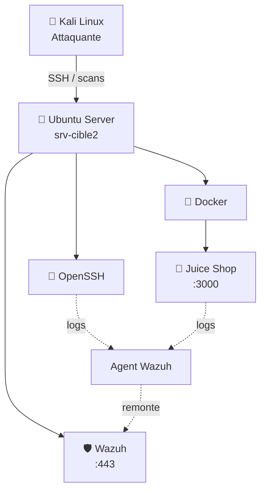

<div align="center">

# 🔐 Mini Labo de Cybersécurité

**Laboratoire virtuel pour l'apprentissage de l'administration Linux, de la conteneurisation et de la détection d'incidents via un SIEM**


Auteur : **Yacine KHIAT**

</div>

---

## 📖 Présentation

Ce projet a pour objectif de concevoir un laboratoire pratique de cybersécurité afin de maîtriser les fondamentaux des domaines suivants :

- 🐧 Administration Linux
- 🌐 Gestion des services réseau
- 🐳 Conteneurisation (Docker)
- 📊 Analyse de logs de sécurité
- 🚨 Détection d'incidents
- 🛡️ Centralisation et corrélation d'événements via un SIEM (Wazuh)

## 💻 Composants du laboratoire

| Machine / Service | Rôle / Description |
|:---|:---|
| 🐉 **Kali Linux** | Machine attaquante (Audit & Tests) |
| 🐧 **Ubuntu Server** | Machine cible (`srv-cible2`) |
| 🔑 **OpenSSH** | Service d'accès distant sécurisé |
| 🧃 **OWASP Juice Shop** | Application web délibérément vulnérable |
| 🐳 **Docker** | Gestionnaire de conteneurs |
| 🛡️ **Wazuh** | SIEM/EDR open-source (Manager, Indexer, Dashboard) |

## 🏗️ Architecture du laboratoire



---

## 🛠️ Étapes de réalisation

<details open>
<summary><b>1️⃣ Création d'un utilisateur de test</b></summary>

Compte dédié pour simuler un utilisateur vulnérable et isoler les tests.

```bash
sudo useradd -m -s /bin/bash testuser
sudo passwd testuser
```

**Ce que j'ai appris :**
- Créer un utilisateur Linux avec son répertoire personnel (`/home/testuser`)
- Attribuer et gérer les mots de passe
- Isoler les activités de test sur un compte restreint

</details>

<details>
<summary><b>2️⃣ Installation & configuration du serveur SSH</b></summary>

```bash
sudo apt update && sudo apt install openssh-server -y
sudo systemctl enable --now ssh
sudo systemctl status ssh
```

> Statut du service : `Active: active (running)`

**Ce que j'ai appris :**
- Installer un service sous Linux via `apt`
- Utiliser `systemctl` pour gérer les démons système
- Comprendre le fonctionnement de l'authentification SSH

</details>

<details>
<summary><b>3️⃣ Installation de Docker</b></summary>

```bash
sudo snap install docker
docker --version
```

**Ce que je me suis approprié :**
- Comprendre le concept d'isolation par conteneurs
- Installer et vérifier le bon fonctionnement de Docker
- Gérer les privilèges d'exécution

</details>

<details>
<summary><b>4️⃣ Déploiement d'OWASP Juice Shop</b></summary>

```bash
sudo docker run -d \
  --name juice-shop \
  -p 3000:3000 \
  bkimminich/juice-shop

sudo docker ps
```

> Redirection de port : `0.0.0.0:3000 -> 3000/tcp`

**Ce que j'ai appris :**
- Télécharger une image depuis Docker Hub
- Exécuter un conteneur en mode détaché (`-d`)
- Rediriger les flux réseau d'un port hôte vers un port conteneur (`-p`)

</details>

<details>
<summary><b>5️⃣ Simulation de connexions SSH depuis Kali Linux</b></summary>

```bash
ssh testuser@IP_SERVEUR
```

**Ce que j'ai appris :**
- Utiliser le client SSH en ligne de commande
- Identifier visuellement une réponse d'authentification réussie ou échouée

</details>

<details>
<summary><b>6️⃣ Analyse manuelle des logs de sécurité</b></summary>

```bash
sudo tail -f /var/log/auth.log
```

```text
Failed password for testuser from 192.168.x.x port 54321 ssh2
Accepted password for testuser from 192.168.x.x port 54321 ssh2
```

**Ce que j'ai appris :**
- Identifier l'adresse IP source et le port d'une tentative d'accès
- Extraire le nom d'utilisateur ciblé
- Analyser `/var/log/auth.log` pour détecter des comportements suspects (ex : brute force)

</details>

<details>
<summary><b>7️⃣ Installation de Wazuh (Manager + Indexer + Dashboard)</b></summary>

```bash
curl -sO https://packages.wazuh.com/4.9/wazuh-install.sh
sudo bash wazuh-install.sh -a

sudo tar -xvf wazuh-install-files.tar
sudo cat wazuh-install-files/wazuh-passwords.txt
```

> ⚠️ **Incident rencontré :** l'indexer (basé sur une JVM) nécessite **4 Go de RAM minimum**. Une première tentative sur une VM sous-dimensionnée a provoqué un `oom-kill` — le processus a été tué par l'OOM Killer du noyau. Diagnostiqué via `systemctl status` et résolu en portant la RAM allouée à **5 Go**.

Accès dashboard : `https://192.168.56.102`

**Ce que j'ai appris :**
- Architecture d'un SIEM (Manager / Indexer / Dashboard)
- Dimensionner les ressources pour un service basé sur la JVM
- Diagnostiquer un échec de service via `systemctl status` (identification d'un `oom-kill`)
- Gestion des certificats auto-signés générés par l'installeur

</details>

<details>
<summary><b>8️⃣ Déploiement de l'agent Wazuh sur srv-cible2</b></summary>

```bash
curl -o wazuh-agent.deb https://packages.wazuh.com/4.x/apt/pool/main/w/wazuh-agent/wazuh-agent_4.9.0-1_amd64.deb
sudo WAZUH_MANAGER='192.168.56.102' dpkg -i ./wazuh-agent.deb

sudo systemctl enable --now wazuh-agent
```

**Ce que j'ai appris :**
- Modèle agent/serveur en cybersécurité
- Transmission sécurisée des événements (ports 1514/1515)

</details>

<details>
<summary><b>9️⃣ Détection automatique du brute force SSH</b></summary>

```bash
for i in {1..6}; do ssh testuser@192.168.56.102 -o PreferredAuthentications=password; done
```

> 🚨 Alerte déclenchée dans **Security Events** : règle **5712 – SSHD brute force trying to get access to the system** (niveau 10)

**Ce que j'ai appris :**
- Lire et interpréter les règles Wazuh (`sshd_rules.xml`)
- Comprendre les niveaux de sévérité (0 à 16)
- Exploiter le dashboard pour une investigation visuelle rapide

</details>

<details>
<summary><b>🔟 Surveillance de Juice Shop via Wazuh</b></summary>

```bash
sudo docker logs -f juice-shop > /var/log/juice-shop.log &
```

```xml
<localfile>
  <log_format>syslog</log_format>
  <location>/var/log/juice-shop.log</location>
</localfile>
```

**Ce que j'ai appris :**
- Intégrer des logs applicatifs non-système dans un SIEM
- Corréler des événements web avec l'activité réseau et système

</details>

---

## 🎯 Synthèse des notions retenues

| Notion | Définition |
|:---|:---|
| **SSH** | Protocole d'accès distant sécurisé chiffré |
| **Docker** | Solution de conteneurisation légère pour isoler des applications |
| **Logs** | Traçabilité essentielle pour l'investigation post-incident |
| **Brute Force** | Attaque par essais/erreurs, détectable via les échecs répétés |
| **SIEM** | Centralise, corrèle et alerte sur les événements de sécurité |
| **Agent/Manager** | Modèle de collecte distribuée des logs |
| **Règle de détection** | Logique transformant un log brut en alerte exploitable |

## ✅ État du projet

- [x] Ubuntu Server installé et configuré
- [x] Kali Linux opérationnelle
- [x] Interconnexion réseau établie
- [x] Service SSH fonctionnel
- [x] Compte utilisateur de test créé
- [x] Docker déployé
- [x] Application Juice Shop opérationnelle
- [x] Wazuh Manager / Indexer / Dashboard installés
- [x] Agent Wazuh déployé sur srv-cible2
- [x] Détection brute force SSH validée
- [x] Logs Juice Shop intégrés
- [ ] Règles de détection personnalisées (`local_rules.xml`)
- [ ] Notifications email/Slack sur alerte critique

## 🚀 Prochaines étapes

- 🔗 Règle de corrélation entre scans Juice Shop (OWASP ZAP) et alertes Wazuh
- 🌐 Intégration VirusTotal / MISP pour enrichir les alertes en threat intel
- 📩 Notifications automatiques sur alertes critiques (niveau ≥ 10)

---

<div align="center">

`srv-cible2` · `192.168.56.102` · Wazuh v4.9.2

</div>
